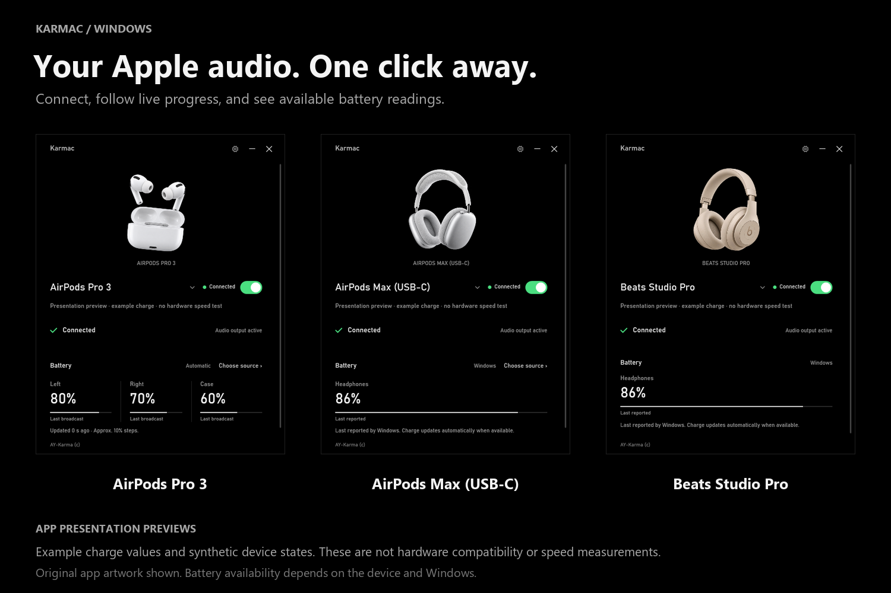
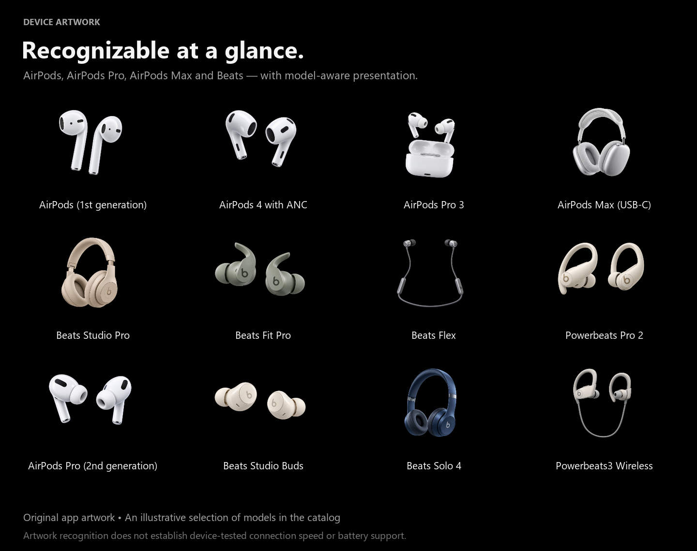
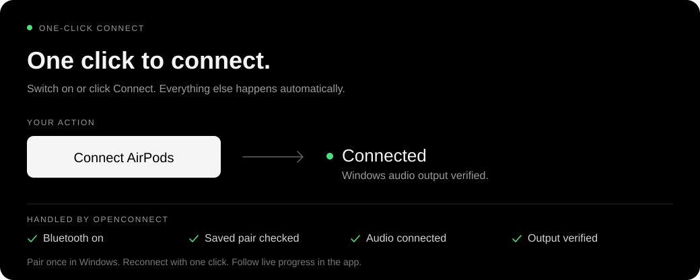
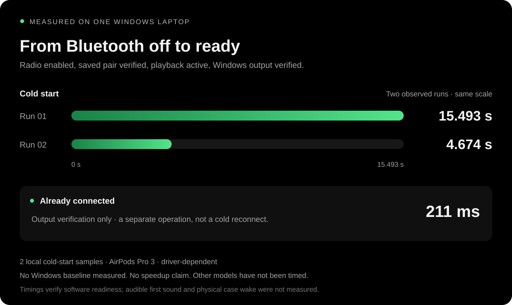

<div align="center">

# Karmac

**Your Apple earphones. One connection switch. Windows audio, ready.**

A small, portable Windows app for reconnecting paired AirPods and Beats, controlling Bluetooth, and seeing exactly what happens between clicking Connect and listening.

<p>
  <strong>Windows 10 / 11</strong> &nbsp;·&nbsp;
  <strong>x64</strong> &nbsp;·&nbsp;
  <strong>Portable</strong>
</p>

[**Download for Windows (x64)**](https://github.com/AY-Karma/Karmac/releases/download/v1.0.0-preview.1/Karmac-Windows-x64.zip) · [SHA-256 checksums](https://github.com/AY-Karma/Karmac/releases/download/v1.0.0-preview.1/SHA256SUMS.txt)

**Private preview:** downloads require access to this repository. This build is **unsigned**. [Download trust](docs/windows-trust.md).

[Get started](#get-started) · [Device compatibility](#device-compatibility) · [Measured connections](#measured-connections) · [Build](#build)



</div>

## Less time in Bluetooth settings

Karmac keeps the connection work in one place: turn on the radio, recover your saved pair, reconnect its audio link, and verify Windows output. You can follow each stage live instead of wondering whether your earphones are connected or where the sound is going.

<table>
  <tr>
    <td width="33%"><strong>One switch</strong><br>Switch on to enable Bluetooth and reconnect your saved earphones. Switch off to turn laptop Bluetooth off entirely, or choose headphones-only disconnection in Settings.</td>
    <td width="33%"><strong>Visible progress</strong><br>Live connection stages, retries, and elapsed timings make the work behind the connection clear.</td>
    <td width="33%"><strong>Audio output verified</strong><br>Karmac switches and checks Windows' default playback roles, then shows a clear ready state.</td>
  </tr>
  <tr>
    <td><strong>Your saved device</strong><br>Reconnect the pair you chose. Nearby devices are never silently substituted for it.</td>
    <td><strong>Battery when available</strong><br>Automatic readings use Windows or verified device data. Optional manual sources are clearly identified.</td>
    <td><strong>Always within reach</strong><br>A tray icon and <kbd>Ctrl</kbd> + <kbd>Shift</kbd> + <kbd>A</kbd> keep the saved pair one action away.</td>
  </tr>
</table>

## Get started

Requires **64-bit Windows 10 or Windows 11**, **.NET Framework 4.8**, and a working Bluetooth adapter. Normal use needs no installer or administrator access.

1. Pair your earphones once through Windows Bluetooth settings.
2. Extract `Karmac-Windows-x64.zip` and run **Karmac.exe**.
3. Choose your saved earphones on the main screen.
4. Click **Connect AirPods** or **Connect Beats**. If Bluetooth is off, you can also switch **on** to enable it and continue the same connection attempt.

Wear the earphones or open their case so they can accept the connection. Once connected, the app verifies Windows audio output. Apps that explicitly select their own output may keep that selection.

> **By default, switching off turns laptop Bluetooth off entirely.** This disconnects all Bluetooth devices, including keyboards, mice, and other audio devices. Your earphones remain paired.

Prefer to keep your mouse or keyboard connected? In **Settings**, turn off **Turn off laptop Bluetooth when disconnecting**. The main switch will then disconnect only the selected headphones and leave laptop Bluetooth on. Switch on to reconnect that pair. This preference is saved; whole-laptop Bluetooth shutdown remains the default.

Closing the window leaves Karmac running in the tray. Press <kbd>Ctrl</kbd> + <kbd>Shift</kbd> + <kbd>A</kbd> to connect the saved pair; use **Settings → Quit app** to exit.

<details>
<summary><strong>What is in the portable package?</strong></summary>

Keep these files together when extracting the app:

| File | Purpose |
| --- | --- |
| `Karmac.exe` | The application. |
| `Karmac.exe.config` | Windows runtime configuration. |
| `README.md` | Setup, usage, compatibility, and measurement notes. |
| `LICENSE` | Karmac's MIT license. |
| `THIRD-PARTY-NOTICES.txt` | Required notices for the open-source implementations used. |
| `docs/assets/` | Visuals used by this README; not required to run the app. |
| `assets/NOTICE.txt` | Image provenance and artwork attribution. |
| `PRIVACY.md`, `SECURITY.md`, `docs/` | Privacy, reporting, compatibility, licensing, and release notes. |

The application does not need a separate browser runtime, Node.js, or a .NET SDK to run.

</details>

## Device compatibility

<p align="center">
  
</p>

Recognizes **30 AirPods and Beats models**, including AirPods Pro and AirPods Max, with device-aware visuals and battery layouts. **AirPods Pro 3 is hardware-tested**; other models have catalog/UI checks only. Connection speed and battery availability vary.

[Compatibility details and current limits](docs/compatibility.md).

## What happens when you connect

<p align="center">
  
</p>

Click **Connect AirPods** or **Connect Beats**, or switch on beside your device name. Karmac automatically handles Bluetooth, your saved pair, the audio connection, and output verification. Live progress appears as it works; timings remain under **Connection details**.

Reconnect requests can bring earphones over from another host when the earphones accept the handoff. An active call, a busy host, firmware behavior, a hardware radio switch, or an administrator restriction can still prevent it; the app reports the failed stage instead of claiming a successful connection.

## Measured connections

<p align="center">
  
</p>

These are **local observations from one Windows laptop and one AirPods Pro 3 pair**, not a benchmark across the catalog.

| Scenario | Recorded duration | Sample size |
| --- | ---: | ---: |
| Cold connect, Bluetooth initially off — run 1 | **15.493 s** | 1 |
| Cold connect, Bluetooth initially off — run 2 | **4.674 s** | 1 |
| Already-connected readiness check | **211 ms** | 1 |
| Default Windows Connect comparison | **Not completed** | 0 |

The cold-connect sample is **two runs**. The readiness check is a different starting state and must not be compared as a cold connect. These values are not averages, guarantees, app-launch timings, or proof of a speed advantage over Windows.

The adapter was confirmed off before each cold-connect run. Earphone sleep state was not controlled. The endpoint was an active playback device with the three Windows output roles verified; first audible sound was not measured. A fair Windows comparison needs the same hardware, starting state, and endpoint. That baseline is not currently available, so no percentage improvement or “times faster” claim is made. Other Apple and Beats models still need physical measurements.

## Scope

Karmac brings Apple **Bluetooth audio** into a focused Windows workflow. It does not implement iCloud pairing, Apple Automatic Switching, Find My, firmware updates, or full Apple-only controls such as noise-cancellation settings. Those features are not implied by a recognized model or its artwork.

## Build

The app uses **C# / WPF on .NET Framework 4.8**, Windows Bluetooth APIs, native Bluetooth audio connections, and Windows audio routing. The build uses the compiler and Windows metadata installed on a compatible Windows system; no NuGet restore is required.

From the project directory in PowerShell:

```powershell
# Build the portable executable and run the core tests.
.\build.ps1 -Test

# Run WPF checks without bringing the app in front of your work.
.\tools\Verify-UI.ps1 -Background -CaptureDirectory artifacts\ui-check

# Build, test, and create the portable ZIP.
.\package.ps1

# Recheck the release's hashes, version, notices, and complete ZIP contents.
.\tools\Verify-Release.ps1
```

Outputs are written to `artifacts/`. Automated tests cover connection-state logic, device identity handling, battery-source boundaries, and UI states. They do not substitute for connection measurements on every supported physical model.

The package command also writes a versioned release folder, `SHA256SUMS.txt`, release notes, and `release.json`. See [release preparation](docs/releasing.md). Binaries belong in GitHub Releases, not source history.

## License and acknowledgments

Karmac is available under the [MIT license](LICENSE). Open-source adaptations and their license text are listed in [THIRD-PARTY-NOTICES.txt](THIRD-PARTY-NOTICES.txt). Artwork details are recorded in [assets/NOTICE.txt](assets/NOTICE.txt).

Apple, AirPods, and Beats are trademarks of their respective owners. Karmac is an independent project and is not affiliated with or endorsed by Apple.

[Privacy](PRIVACY.md) · [Security](SECURITY.md) · [Licensing details](docs/licensing.md)

<div align="center">
  <sub>AY-Karma (c)</sub>
</div>
