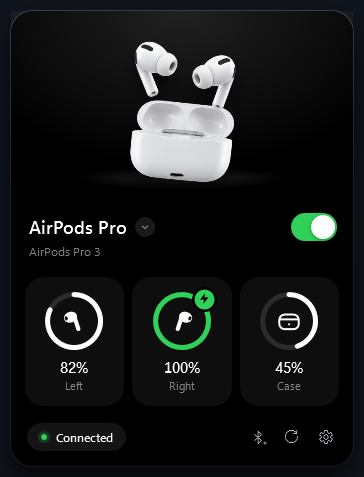

#  Karmac

**AirPods for Windows, one click from the taskbar.**



## What it does

- **Connect in one click.** Click the taskbar icon, flip the switch, and your AirPods connect and take over Windows audio.
- **See their charge.** Left, right and case battery, in the flyout or on hover.
- **Pop-up card.** Open the case nearby and a card rises from the taskbar, ready to connect.
- **Shortcut.** `Ctrl` + `Alt` + `K` connects or disconnects from anywhere.

AirPods only. Windows 10 / 11, 64-bit, with a Bluetooth adapter.

## Use it

1. Pair your AirPods once in Windows Bluetooth settings.
2. Run `Karmac.exe`. Its icon appears beside the clock.
3. Click it, then **Connect**.

Quit from **Settings → Quit Karmac**. No installer, no admin rights.

> Preview software, unsigned. Windows may warn before running it. See [download trust](docs/windows-trust.md).

## Build

Needs Windows with .NET Framework 4.8. No NuGet restore.

```powershell
.\build.ps1 -Test        # build and run the tests
.\package.ps1            # build, test and create the portable ZIP
```

Output goes to `artifacts/`. More in [releasing](docs/releasing.md).

## More

[Privacy](PRIVACY.md) · [Security](SECURITY.md) · [Compatibility](docs/compatibility.md) · [Licensing](docs/licensing.md) · [MIT license](LICENSE)

Apple and AirPods are trademarks of their respective owners. Karmac is independent and not affiliated with or endorsed by Apple.
